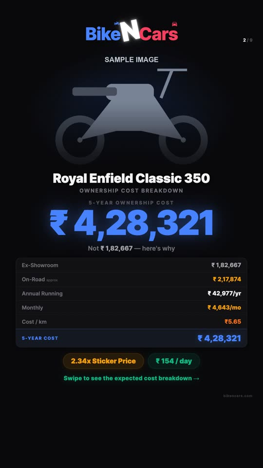
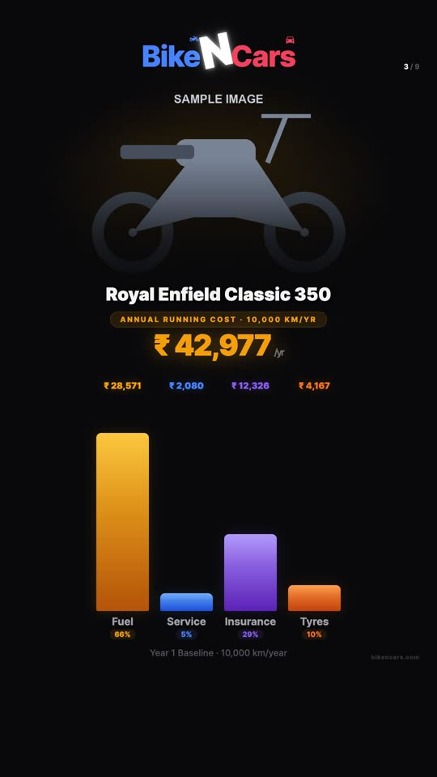
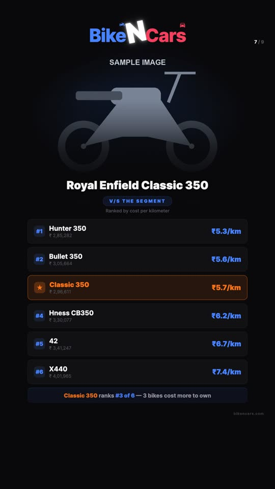
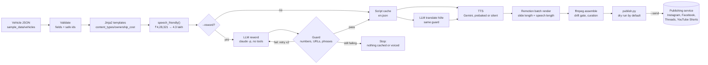

# data-to-video

Turns rows of vehicle data into narrated 9:16 reels in English, Hindi and Telugu, with an LLM in the loop for wording and translation and a code guard that refuses any script whose numbers do not match the data.

[](https://github.com/himanshumehta/data-to-video/actions/workflows/ci.yml)
[](LICENSE)


## Demo

Frames from the 76-second 1080×1920 reel that `make demo` renders from the sample data, with no API keys. The vehicle pictures are generated placeholder silhouettes.

| Hook: 5-year cost | Annual running cost | Segment ranking |
|---|---|---|
|  |  |  |

## Why it exists

A buyer cares about what a vehicle costs to own: fuel, service, insurance, tyres and resale. That data sat in a database, while every short video still had to be scripted, voiced and edited by hand, once per language. This pipeline turns one data row into a voiced reel per language and reuses each reel on four networks. Hand-editing does not scale to hundreds of vehicles. A language model can write varied scripts, but it cannot be trusted with numbers, so the design question is how to let it write without letting it change the facts.

## Architecture



Each stage is a separate script you can run alone. `scripts/ownership_pipeline.py` runs them in order (`--step preview|narrate|render|assemble|publish`) and stops the run when a check fails.

| Component | Responsibility | Key file |
|---|---|---|
| Data loader | Read `<slug>.json`, validate every value that becomes a path | `scripts/lib/vehicle_data.py` |
| Narration | Render templates, call the LLM, run the guard, voice each slide | `scripts/narrate.py` |
| LLM client | Reword and translate prompts, corrective retries | `scripts/lib/reword.py` |
| Guard | Compare numbers, find URLs and banned phrases in model output | `scripts/lib/guard.py` |
| TTS | Gemini TTS with 429 back-off, resample to 48 kHz | `scripts/lib/tts.py` |
| Render queue | Map slides to Remotion compositions, time each one to its narration | `scripts/remotion_render.py` |
| Batch renderer | Bundle once, render N slides in parallel, hold the last frame | `remotion/scripts/render-batch.mjs` |
| Slides | Ten React components for the 9:16 reel | `remotion/src/slides/reels/` |
| Assembler | Curate to the time limit, drift gate, ffmpeg filter graph, thumbnail | `scripts/assemble.py`, `scripts/lib/curate.py` |
| Fan-out | One master → targets and languages per network | `config/platforms.json`, `scripts/publish.py` |
| Content type | Templates, slide order, curation scores, Remotion registry | `content_types/ownership_cost/` |

## Design decisions and trade-offs

**The LLM rewrites text that was already rendered from data; it never sees raw numbers to format.**
Why: templates plus `speech_friendly()` decide how every figure is spoken (`₹ 4,28,321` becomes "rupees 4.3 lakh", matching the `₹4.3L` on screen). The model only changes the words around the figures.
Trade-off: less freedom for the model. Asking it to write from the raw JSON would give more varied scripts, but there would be no source text to check its numbers against.

**The guard compares sets of numbers, not meaning.**
Why: it is deterministic, needs no second model call, and catches the failure that matters most (a private run voiced "2.69 times" where the data said 2.51). Indic digits are normalised, so `२.५१` counts as 2.51.
Trade-off: numbers written as words count as missing, so the guard sometimes rejects a correct translation. The prompts ask for digits, and a rejection costs a retry, not a wrong video. An LLM judge was rejected because it would need checking itself.

**Non-English scripts are translated from the cached English script, not from the templates.**
Why: every language tells the same story with the same figures, and the English text is the reference the guard checks the translation against.
Trade-off: English has to be produced first. Without an English cache the pipeline falls back to the per-language templates (no LLM).

**Narration sets the timing.**
Why: each slide animates once (50–90 frames at 30 fps) and is then held on its last frame until the end of its speech, found with ffmpeg `silencedetect`. Rendering only the animated frames keeps renders short.
Trade-off: a slide cannot animate during narration. The render refuses to start if any slide lacks its WAV, and assembly refuses if a clip and its narration differ by more than 2 s.

**One master per aspect ratio, cut to the strictest target.**
Why: the 9:16 master goes to Instagram Reels, Facebook Reels, Threads and YouTube Shorts. Its time limit is the shortest `max_duration_s` among those targets (90 s). If a reel runs longer, `curate.py` keeps the intro, hook and end card, then adds slides by interest per second and keeps the story order.
Trade-off: YouTube Shorts allows 180 s but gets the 90 s cut. A second render per target was rejected because it would double render and review time for little gain.

**Content types are folders, not branches.**
Why: the shared scripts import `content_types/<type>/narrations/<platform>.py`, `assembly/<platform>.py`, `curation.py` and `remotion.json` by name. Car-specific templates are picked by a `_car` module suffix, not an `if` in shared code.
Trade-off: a new content type means a new folder of boilerplate. This repo ships one content type, so the abstraction is lightly exercised.

**Paid calls and publishing are opt-in.**
Why: Gemini TTS needs `--tts gemini`, the LLM reword needs `--reword`, and publishing needs `--send`. `--tts auto` picks prebaked or silent audio, never Gemini, even when a key is set.
Trade-off: the full path needs more flags than the demo.

## Agentic and AI specifics

- **Where models sit.** Two places only: the Claude Code CLI for English reword and translation (`scripts/lib/reword.py`), and Gemini 2.5 Flash TTS for audio (`scripts/lib/tts.py`). Everything else (validation, timing, curation, assembly, fan-out) is deterministic code.
- **Guardrails on model output** (`scripts/lib/guard.py`):
  - the output must contain exactly the numbers of its source text, plus the model name's own number ("Classic 350");
  - no URL, domain or "dot com";
  - (English) none of 31 banned stock phrases.

  A failure is sent back to the model with the exact problem, for example `missing or changed numbers: 2.51; numbers not in the source: 2.69`. After two failed retries the run exits and writes nothing.
- **Stale caches.** A cached LLM script is reused only if its numbers still match freshly rendered templates. If the vehicle data changed, the run stops and asks for `--reword` or `--retranslate`.
- **Least privilege for the LLM.** The CLI runs as `claude -p --tools ""` with the prompt on stdin and a 180 s timeout, so the model can return text but cannot read or write files.
- **Fallbacks.** No credentials: prebaked audio (when it ships) or silent clips timed from the word count (2.5 words/s). No English cache: per-language templates. Gemini 429: waits the `retryDelay` the API returns, up to 3 times.
- **Determinism.** The same data and templates give the same script and the same curation. Only the LLM and TTS steps vary, and their output is cached per language.
- **Cost and latency controls.** One TTS call per slide with a 25 s gap (free-tier quota), cached WAVs reused unless `--force`, one Remotion bundle shared by all slide renders, `--scale 1` for drafts.
- **Human in the loop.** Publishing is a dry run that prints every payload until you pass `--send`. `npm run gallery` previews every slide with the current vehicle before a render.
- **Evals.** `tests/test_guard.py` runs the real retry-and-refuse loop against a fake `claude` executable that replays scripted answers: the known 2.51 → 2.69 drift, a URL, a banned phrase. It also runs the guard over the shipped sample scripts. On the prebaked Royal Enfield Classic 350 narration it flags 4 English slides (3 banned phrases, 1 "dot com") and 2 Hindi slides (year numbers said as words, "dot com"). That audio predates the guard, so `make demo` prints these as warnings and plays it as shipped.

## Reliability and operations

- **Fail before you spend.** Missing required fields, a missing image, a missing WAV or more than 2 s of clip-to-narration drift each stop the run before the expensive step that would follow.
- **Idempotency.** Existing WAVs are skipped unless `--force`. `remotion_render.py --resume` skips rendered clips. Every publish request carries an `Idempotency-Key` (SHA-256 of slug, content type, target, language and the video's own SHA-256), so a retried upload can be de-duplicated by the service.
- **Staleness.** `narrate.py --check-staleness` compares the vehicle fields each slide's template uses with the snapshot saved at the last generation (`.narrate_state.json`) and lists stale slides.
- **Partial failure.** A failed TTS slide is logged and the others continue. The render then refuses to start until every slide has audio. A failed publish target is reported and the others are still sent; the exit code is non-zero.
- **Observability.** Plain logs on stdout per stage. The batch renderer writes `output/_work/render-queue-results.json` with per-job status and seconds.

## Security

The pipeline runs on the operator's machine. The untrusted inputs are CLI arguments, vehicle JSON files and model output. Every slug, language, content type and platform is checked against a strict pattern before it becomes a path. Image paths must be `https://` or `vehicles/<file>.png`. All subprocesses get argument lists (no shell). The LLM runs without tools. The publisher token only travels over https (or to localhost) and is never printed. CI runs `pip-audit`, `npm audit`, `bandit` and `gitleaks`, and Dependabot watches pip, npm and Actions. See [SECURITY.md](SECURITY.md) for the threat model, the controls and what is out of scope.

## Quickstart

You need Python 3.11 or newer, Node.js 20.19 or newer, `ffmpeg` on your PATH, and `make`. No API keys or accounts.

```bash
git clone https://github.com/himanshumehta/data-to-video.git
cd data-to-video
make setup   # .venv with the newest Python 3.11+ on PATH, then `npm ci` in remotion/
make demo    # sample data -> prebaked English narration -> render -> MP4 -> publish dry run
```

The first render downloads Chrome Headless Shell for Remotion. A completed run prints `PIPELINE COMPLETE` after a dry run of the 4 publish payloads. The video is written to:

```
output/royal-enfield/royal-enfield-classic-350-2024/ownership_cost/default/instagram-reels/en/video.mp4
```

Measured on an Apple M2 Max: the batch renderer produced the 10 slide jobs in 31.7 s, and the result is a 75.8 s, 1080×1920 H.264/AAC file of 6.6 MB with at most 0.1 s of drift between any slide and its narration.

Other runs that need no credentials:

```bash
make demo-hi                          # same vehicle, prebaked Hindi narration
make demo-silent SLUG=hyundai-creta   # any of the 5 sample vehicles (this one uses the car templates)
```

The full path with real models is optional. It needs a Gemini API key and, for reword and translation, the [Claude Code](https://docs.claude.com/en/docs/claude-code) CLI installed and logged in:

```bash
cp .env.example .env                  # then set GEMINI_API_KEY
.venv/bin/pip install -r requirements-tts.txt
.venv/bin/python scripts/ownership_pipeline.py --slug ktm-250-duke --lang en --tts gemini --reword --force
.venv/bin/python scripts/ownership_pipeline.py --slug ktm-250-duke --lang hi --tts gemini --force
.venv/bin/python scripts/publish.py output/ktm/ktm-250-duke/ownership_cost/default/instagram-reels/en --send
```

Without `make`, `--scale` defaults to 2 (a 2160×3840 master with sharper text). To preview slides live, run `cd remotion && npm run gallery`.

### Configuration

Every variable is optional. Copy `.env.example` to `.env`; the scripts read it, and real environment variables take precedence.

| Variable | Default | Purpose |
|---|---|---|
| `GEMINI_API_KEY` | unset | Gemini TTS key, used only with `--tts gemini` |
| `GOOGLE_CLOUD_PROJECT` / `GOOGLE_CLOUD_LOCATION` | unset / `us-central1` | Use Vertex AI for TTS instead of an API key (needs ADC) |
| `GEMINI_TTS_MODEL` | `gemini-2.5-flash-preview-tts` | TTS model |
| `SOCIAL_PUBLISHER_URL` | unset | Base URL of the publishing service; posts go to `$URL/v1/posts`. Must be https unless localhost |
| `SOCIAL_PUBLISHER_TOKEN` | unset | Bearer token for that service, sent only with `--send` |
| `VEHICLE_DATA_DIR` | `sample_data/vehicles` | Folder of `<slug>.json` files |
| `VEHICLE_IMAGE_DIR` | `sample_data/images` | Transparent vehicle PNGs |
| `PREBAKED_NARRATION_DIR` | `sample_data/narration` | Pre-generated clips `<slug>/<lang>/<slide>.mp3` |
| `BGM_PATH` | unset | Background music file. None ships; tracks in `assets/music/` also work |
| `BRAND_HASHTAG` | `#BikeNCars` | Hashtag in generated descriptions |
| `VITE_PORT` | `5173` | Port for the slide gallery |

Where each video goes is set in `config/platforms.json`: format → targets, and per target the network, accepted languages and time limit. Channel credentials live in the publishing service, not here.

### Testing

```bash
make test    # 64 offline tests, about 2 s
make lint    # ruff + TypeScript type-check of slides and gallery
make audit   # pip-audit, bandit, npm audit
```

| File | Tests | Covers |
|---|---|---|
| `tests/test_pipeline.py` | 26 | Sample data completeness, every template renders for every vehicle in en and hi, curation respects the limit and story order, fan-out targets, registry ↔ component wiring |
| `tests/test_guard.py` | 9 | Number extraction (Indian grouping, Devanagari, Telugu), the 2.51 → 2.69 case, URL detection, retry and refusal through a fake `claude`, CLI flags |
| `tests/test_security.py` | 29 | Path traversal in slugs, vehicle files and image paths, output path validation, publisher URL rules, dry run sends nothing and prints no token |

Rendering and ffmpeg assembly are covered by `make demo`, not by unit tests.

## Project layout

```
scripts/
  ownership_pipeline.py   runs the stages in order
  narrate.py              templates -> LLM (guarded) -> TTS
  remotion_render.py      render queue from remotion.json
  assemble.py             curation, drift gate, ffmpeg
  publish.py              fan-out, dry run, upload
  lib/                    guard, reword, tts, curate, platforms, vehicle_data, number_format
content_types/ownership_cost/
  narrations/             Jinja2 templates per language (bike and car)
  assembly/               slide order and post descriptions
  curation.py             per-slide interest scores
  remotion.json           slide id -> component, format, platform
remotion/
  src/slides/reels/       the 10 slide components
  scripts/render-batch.mjs
  src/gallery/            live preview (npm run gallery)
config/platforms.json     targets, languages and time limits per network
sample_data/              5 vehicles, placeholder images, prebaked en/hi narration for one
tests/
```

## Limitations and roadmap

- One content type (ownership cost) and one format (9:16) ship. The 16:9, 4:5 and other content types from the original project were removed because they did not run on the sample data.
- Sample data is 5 vehicles with spec, price and ownership-cost fields. The live database loader is not included. Point `VEHICLE_DATA_DIR` at your own JSON or replace `load_vehicle()`.
- The guard checks numbers, not meaning. A model could still drop a qualifier such as "estimated". A semantic check on qualifier words is the next step.
- The prebaked sample narration predates the guard and contains "dot com" and banned phrases (see the warnings in the `make demo` log).
- `--tts silent` sizes clips from word count. Use it for render tests, not for publishing.
- The LLM step needs the Claude Code CLI. A direct API client with structured output would remove that dependency.
- Publishing is a client for a separate service. This repo never calls social network APIs.

## Licence

The code is MIT-licensed (see [LICENSE](LICENSE)).

- **Remotion** has its own licence; some companies need a paid licence for commercial use. See remotion.dev/license.
- **Inter** (loaded through `@remotion/google-fonts`) is under the SIL Open Font License.
- **Data and brand.** The BikeNCars name and logo and the vehicle data in `sample_data/` belong to bikencars.com, and vehicle names belong to their manufacturers. They are included only to make the demo reproducible and are not covered by the MIT licence.
- **Images.** `sample_data/images/` holds generated placeholder silhouettes, not manufacturer photos.
- **Music.** None is included; bring your own licensed tracks.

## Author

Built by **Himanshu Mehta** — staff engineer, 10+ years building large-scale distributed systems at Outreach, Builder.ai and Twilio; now building agentic AI systems. [LinkedIn](https://www.linkedin.com/in/himanshu-mehta-29920525) · [GitHub](https://github.com/himanshumehta)

Related projects: [data-to-video](https://github.com/himanshumehta/data-to-video) · [social-publisher](https://github.com/himanshumehta/social-publisher) · [vehicle-image-studio](https://github.com/himanshumehta/vehicle-image-studio) · [multi-brand-design-system](https://github.com/himanshumehta/multi-brand-design-system)
