# data-to-video

Turns a vehicle database into narrated short videos in English and Hindi, rendered on a design system and published to 6 social platforms.

## Demo

Frames from the 76-second 9:16 reel that `make demo` renders from the sample data. The narration is pre-generated English audio that ships in `sample_data/`.

| Hook: 5-year cost | Annual running cost | Segment ranking |
|---|---|---|
|  |  |  |

## Why it exists

A vehicle buyer cares about what the vehicle costs to own: fuel, service, insurance, tyres and resale value. That data was sitting in a database while every short video still had to be scripted, voiced and edited by hand. This pipeline turns each database row into a data-checked, voiced reel in several languages and aspect ratios, so a library of hundreds of vehicles needs no editing timeline.

## Architecture

```mermaid
flowchart LR
  A["Vehicle data<br/>sample_data/vehicles/*.json"] --> B["Validate<br/>ownership_pipeline.py"]
  B --> C["Narration templates (Jinja2)<br/>content_types/&lt;type&gt;/narrations/"]
  C --> D{"LLM step<br/>claude -p"}
  D -- "EN: reword, same numbers" --> E["Script cache<br/>en.json"]
  E -- "translate" --> F["hi / te / mr scripts"]
  E --> G["TTS<br/>Gemini, prebaked or silent"]
  F --> G
  G --> H["One WAV per slide"]
  H -- "durations" --> I["Render queue<br/>remotion.json + design system"]
  I --> J["Remotion batch render<br/>render-batch.mjs"]
  J --> K["Assemble (ffmpeg)<br/>thumbnail flash + slides + narration"]
  K --> L["video.mp4, thumbnail.jpg,<br/>description.txt"]
  L --> M["publish.py<br/>fan-out from config/platforms.json"]
  M -- "HTTP POST" --> N[("social-publisher<br/>service")]
  N --> O["YouTube, Instagram, Facebook,<br/>Threads, LinkedIn, X"]
```



Each box is a separate script that you can run on its own (`--step narrate|render|assemble|publish`). `scripts/ownership_pipeline.py` runs them in order and stops the run if any check fails.

## Key ideas

- **Templates drive everything, and content types are isolated.** The shared scripts (`narrate.py`, `remotion_render.py`, `assemble.py`) contain no content-type logic. They import `content_types/<type>/narrations/<platform>.py`, `assembly/<platform>.py` and `remotion.json` by name. To add a content type you add a folder. You never add a branch to shared code.
- **Numbers are spoken from data, and the LLM may not change them.** Narration starts as Jinja2 templates. These switch wording when the data is "estimated" or "projected" instead of "verified". `speech_friendly()` turns `₹ 4,28,321` into "rupees 4.3 lakh". The optional LLM reword must keep every amount, distance, ratio and rating word-for-word. It may not say any URL. Its output is checked against a banned-phrase list and the LLM is re-prompted if a phrase gets through. Other languages are translated from the cached English script, so every language tells the same story.
- **Narration sets the timing.** The renderer refuses to start until every slide has its WAV. Each slide animates once and is then held on its last frame (ffmpeg `tpad`) to the length of its narration. Assembly blocks if any slide's video and audio lengths differ by more than 2 s.
- **One render per aspect ratio, many destinations.** A 9:16 master goes to Instagram Reels, Facebook Reels, Threads and YouTube Shorts. Hindi uses the same slide compositions with its own audio and timing. `assemble.py` trims reels to the platform time limit (90 s on Instagram, Facebook and Threads) by scoring each slide's value per second while keeping the story order: opener, body, comparison, close.
- **Platform-safe layout.** Every reel opens with a 300 ms thumbnail frame, so networks that use frame 0 as the cover show the right image. The vehicle image is preloaded on frame 0. A `SafeZone` component has margin presets for each aspect ratio that keep text clear of each app's UI overlays. The 4:5 slides use it; the 9:16 slides apply the same margins by hand.
- **Design systems are data.** `design-systems/<name>/theme.json` is the source of truth for colours and fonts. It is passed into every slide as props and compiled to CSS for the HTML templates (`scripts/theme_compiler.py`).

## Quickstart

You need Python 3.9 or newer, Node.js 20.19 or newer (tested on Node 26), `ffmpeg` on your PATH, and `make`. You need no API keys or accounts.

```bash
git clone <this-repo-url> data-to-video
cd data-to-video
make setup   # creates .venv and runs `npm ci` in remotion/
make demo    # sample data -> pre-generated English narration -> render -> MP4
```

The first render downloads Chrome Headless Shell (about 80 MB) for Remotion. A completed run prints `PIPELINE COMPLETE`, followed by a dry run of the publish payloads. The video is written to:

```
output/royal-enfield/royal-enfield-classic-350-2024/ownership_cost/default/instagram-reels/en/video.mp4
```

Other runs that need no credentials:

```bash
make demo-hi                          # same vehicle, Hindi narration
make demo-silent SLUG=hyundai-creta   # any of the 5 sample vehicles, silent placeholder narration
make test                             # offline unit tests
```

Full path with real AI (optional). You need a Gemini API key. For the reword and translate step you also need the [Claude Code](https://docs.claude.com/en/docs/claude-code) CLI (`claude`) installed and logged in.

```bash
cp .env.example .env                  # then set GEMINI_API_KEY
.venv/bin/pip install -r requirements-tts.txt
.venv/bin/python scripts/ownership_pipeline.py --slug ktm-250-duke --lang en --tts gemini --reword --force
.venv/bin/python scripts/ownership_pipeline.py --slug ktm-250-duke --lang hi --tts gemini --force
.venv/bin/python scripts/publish.py output/ktm/ktm-250-duke/ownership_cost/default/instagram-reels/en --send
```

`--scale 2` (the default without `make`) renders a 2160×3840 master for sharper text. The demo uses `--scale 1` (1080×1920) because it is faster. To preview slides live, run `cd remotion && npm run gallery`.

## Configuration

Every variable is optional. Copy `.env.example` to `.env`; the scripts read it automatically.

| Variable | Used by | Purpose |
|---|---|---|
| `GEMINI_API_KEY` | `narrate.py --tts gemini` | Gemini TTS (AI Studio key) |
| `GOOGLE_CLOUD_PROJECT` / `GOOGLE_CLOUD_LOCATION` | `narrate.py` | Use Vertex AI for TTS instead of an API key (needs ADC) |
| `GEMINI_TTS_MODEL` | `narrate.py` | TTS model override (default `gemini-2.5-flash-preview-tts`) |
| `SOCIAL_PUBLISHER_URL` | `publish.py --send` | Base URL of the publishing service; videos go to `$URL/v1/posts` |
| `SOCIAL_PUBLISHER_TOKEN` | `publish.py --send` | Bearer token for that service |
| `VEHICLE_DATA_DIR` | all steps | Folder of `<slug>.json` vehicle files (default `sample_data/vehicles`) |
| `VEHICLE_IMAGE_DIR` | render | Transparent vehicle PNGs (default `sample_data/images`) |
| `PREBAKED_NARRATION_DIR` | `narrate.py --tts prebaked` | Pre-generated clips `<slug>/<lang>/<slide>.mp3` (default `sample_data/narration`) |
| `BGM_PATH` | `assemble.py` | Background music file. None ships with the repo; tracks in `assets/music/` also work |
| `BRAND_HASHTAG` | `assemble.py` | Brand hashtag in generated descriptions (default `#BikeNCars`) |
| `VITE_PORT` | `npm run gallery` | Port for the live slide gallery (default 5173) |

Where each video is sent is set in `config/platforms.json`, which maps aspect ratio to targets and lists the languages each target takes. Channel credentials live in the publishing service, not in this repo.

## Results

These counts can be checked in this repository:

- 5 content-type folders: `ownership_cost` is in production. `owner_verdict`, `service_bill_insight`, `vehicle_review` and `ownership_cost_demo` are work in progress.
- 90 Remotion slide components in `remotion/src/slides/`, 3 design systems and 70 HTML templates.
- 14 narration modules and 12 assembly modules. Ownership-cost reels have narration in en, hi and te; landscape YouTube adds mr.
- The demo render on an Apple M2 Max ran 10 Remotion jobs in 27.0 s. It produced a 75.8 s, 1080×1920 H.264/AAC file of 11.1 MB, with a maximum slide-to-narration drift of 0.1 s.
- 24 offline tests (`make test`).

From the private source project (not included here): its output folder holds 303 assembled `video.mp4` files for 35 vehicles. That count includes the copies made when one video is fanned out to several platforms.

## Status, limits and licence

**Status.** The ownership-cost reel (9:16) is the production path and the one the demo exercises. The other content types are included as work in progress. The HTML templates for static carousel images are included, but the database-bound generator that filled them is not.

**Limits.**
- The live database loader was replaced with `sample_data/`: 5 vehicles with spec, price and ownership-cost fields only. To use your own data, set `VEHICLE_DATA_DIR` or swap out `scripts/lib/vehicle_data.py`.
- LLM translation is not checked against the numbers in the data. In one private run, a Hindi script said "2.69 times" when the data said 2.51. Have a human review non-English scripts before you publish them.
- The pre-generated sample narration was produced before the URL and banned-phrase checks were added. It says "bikencars dot com" and "Bookmark".
- `--tts silent` estimates each slide's length from its word count. Use it to test renders, not to publish.
- Publishing is a client for a separate social-publisher service. This repo never calls social network APIs directly, and `publish.py` only does a dry run unless you pass `--send`.

**Licence.** The code is MIT-licensed (see `LICENSE`). **No music is included**: bring your own licensed tracks. The BikeNCars name and logo and the vehicle data in `sample_data/` belong to bikencars.com; vehicle names belong to their manufacturers. They are included only to make the demo reproducible and are not covered by the MIT licence. The vehicle pictures in `sample_data/images/` are generated placeholder silhouettes, not manufacturer photos: point `VEHICLE_IMAGE_DIR` at transparent PNGs you have the rights to. Remotion has its own licence terms for commercial use; see remotion.dev/license.
